This home-page abstract contains inline math $\nabla \cdot \mathbf{E} = \frac{\rho}{\varepsilon_0}$ and $\alpha_i + \beta_j$.

<!-- more -->

### Latex tests

Here are various LaTeX formulas to test rendering capabilities:

#### Inline Formulas

Einstein's famous equation: $E = mc^2$ shows the relationship between energy and mass.

The quadratic formula $x = \frac{-b \pm \sqrt{b^2 - 4ac}}{2a}$ solves $ax^2 + bx + c = 0$.

The Pythagorean theorem states that $ a^2 + b^2 = c^2 $ for right triangles.

#### Centered Equations

Newton's second law of motion:

$$
F = m \cdot a
$$

Euler's identity, often considered the most beautiful equation in mathematics:

$$
e^{i\pi} + 1 = 0
$$

The Gaussian integral:

$$\int_{-\infty}^{\infty} e^{-x^2} dx = \sqrt{\pi}$$

#### Begin/End Blocks

A matrix representation:

$$
\begin{array}{ccc}
  a & b & c \\
  d & e & f \\
  g & h & i
\end{array}
$$

A system of linear equations:

$$
\begin{aligned}
  3x + 2y - z &= 1 \\
  2x - 2y + 4z &= -2 \\
  -x + \frac{1}{2}y - z &= 0
\end{aligned}
$$

A piecewise function definition:

$$
\begin{cases}
  x^2 & \text{if } x \geq 0 \\
  -x^2 & \text{if } x < 0
\end{cases}
$$

#### Left/Right Delimiters

The expectation value in quantum mechanics:

$$\left\langle \psi \right| \hat{A} \left| \psi \right\rangle$$

A binomial coefficient:

$$\binom{n}{k} = \left( \begin{array}{c} n \\ k \end{array} \right) = \frac{n!}{k!(n-k)!}$$

The Legendre symbol:

$$
\left( \frac{a}{p} \right) = \begin{cases}
  1 & \text{if } a \text{ is a quadratic residue modulo } p \text{ and } a \not\equiv 0 \pmod{p} \\
  -1 & \text{if } a \text{ is a quadratic non-residue modulo } p \\
  0 & \text{if } a \equiv 0 \pmod{p}
\end{cases}
$$

#### Complex Expressions

The Fourier transform:

$$\mathcal{F}[f(t)] = \int_{-\infty}^{\infty} f(t) e^{-i\omega t} dt$$

Schrödinger's equation:

$$i\hbar\frac{\partial}{\partial t}\Psi(\mathbf{r},t) = \left [ -\frac{\hbar^2}{2m}\nabla^2 + V(\mathbf{r},t)\right ] \Psi(\mathbf{r},t)$$

Maxwell's equations in differential form:

$$
\begin{aligned}
\nabla \cdot \mathbf{E} &= \frac{\rho}{\varepsilon_0} \\
\nabla \cdot \mathbf{B} &= 0 \\
\nabla \times \mathbf{E} &= -\frac{\partial\mathbf{B}}{\partial t} \\
\nabla \times \mathbf{B} &= \mu_0\mathbf{J} + \mu_0\varepsilon_0\frac{\partial\mathbf{E}}{\partial t}
\end{aligned}
$$
### Formula Stress Tests

#### Dense Inline Expressions

Nested fractions, roots, superscripts, and subscripts: $\displaystyle x_{n+1} = x_n - \frac{f(x_n)}{f'(x_n)} = \sqrt[3]{1 + \sqrt{\frac{a_1^2 + b_1^2}{1 - \gamma_{ij}^{(k)}}}}$.

Accents, tensors, and operators: $\tilde{\nabla}_{\mu} T^{\mu\nu}{}_{\lambda} = \ddot{\mathcal{Q}}^{\nu}{}_{\lambda} + \widehat{\mathbf{R}}^{\alpha\beta}$ and $\operatorname*{arg\,min}_{\theta \in \Theta} \sum_{i=1}^{n} \mathcal{L}_i(\theta)$.

Text and escaped delimiters inside math: $\mathcal{S} = \left\{ x \in \mathbb{R} \mid |x| \leq 1,\ \text{and } x \neq 0 \right\}$.

Symbols that otherwise matter to Markdown: $\alpha_i^{*} + \beta_j^{**} + \gamma_{k\_\ell} \quad \text{and} \quad \mathbf{x}^{\mathsf{T}} \mathbf{A} \mathbf{x}$.

#### Delimiters and Arrays

Scaled delimiters around a tall nested expression:

$$
\left\| \frac{\mathbf{A}^{-1}\mathbf{x}}{1 + \left\langle \mathbf{u}, \mathbf{v} \right\rangle} \right\|_2
\leq
\left[ \frac{\sum_{i=1}^{n} |x_i|^p}{\prod_{j=1}^{m} (1 + y_j^2)} \right]^{1/p}
$$

A matrix with nested fractions, dots, and aligned entries:

$$
\mathbf{M} =
\begin{bmatrix}
\frac{1}{\sqrt{2}} & \alpha_{12} & \cdots & \beta_1 \\
0 & \mathbf{I}_{n \times n} & \ddots & \vdots \\
\gamma_1 & \cdots & \frac{a+b}{c+d} & \omega_n
\end{bmatrix}
$$

#### Alignment and Line Breaks

A derivation with alignment markers, text annotations, and ordinary LaTeX row breaks:

$$
\begin{aligned}
\mathcal{L}(\theta)
&= \mathbb{E}_{x \sim p(x)}\left[\log p_\theta(x)\right] \\
&= \sum_{i=1}^{n} \left( \frac{1}{2}\|f_\theta(x_i)\|^2 - \lambda_i x_i \right)
  && \text{objective} \\
&= \sum_{i=1}^{n} \left( \frac{\alpha_i^2 + \beta_i^2}{2} \right)
  && \text{quadratic form} \\
&\leq \sum_{i=1}^{n} \left( \frac{\alpha_i^2 + \beta_i^2}{2} \right)
  && \text{upper bound}
\end{aligned}
$$

An aligned system mixing matrices and cases:

$$
\begin{aligned}
\dot{\mathbf{x}} &= \mathbf{A}\mathbf{x} + \mathbf{B}\mathbf{u}, \\
\mathbf{y} &= \mathbf{C}\mathbf{x}, \\
u(t) &=
\begin{cases}
-1 & t < 0, \\
0 & t = 0, \\
1 & t > 0.
\end{cases}
\end{aligned}
$$

#### Long Expressions

A continued fraction with deep nesting:

$$
\cfrac{1}{1 + \cfrac{1}{2 + \cfrac{1}{3 + \cfrac{1}{4 + \cfrac{1}{5 + \cfrac{1}{6 + \cdots}}}}}}
$$

A probability expression combining products, sums, integrals, and limits:

$$
\lim_{N \to \infty}
\frac{1}{N}
\log \left[
\prod_{k=1}^{N}
\int_{-\infty}^{\infty}
\exp\left(-\frac{(x-\mu_k)^2}{2\sigma_k^2}\right)
\,\mathrm{d}x
\right]
=
-\sum_{k=1}^{\infty} p_k \log p_k
$$

### Mermaid Diagrams

#### Flowchart

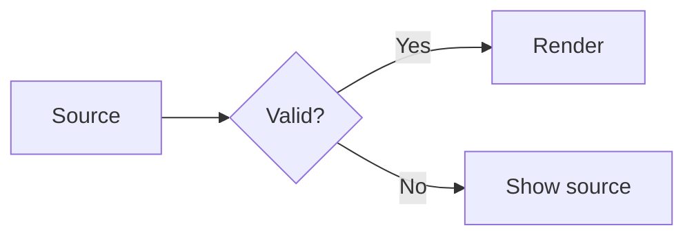

#### Sequence

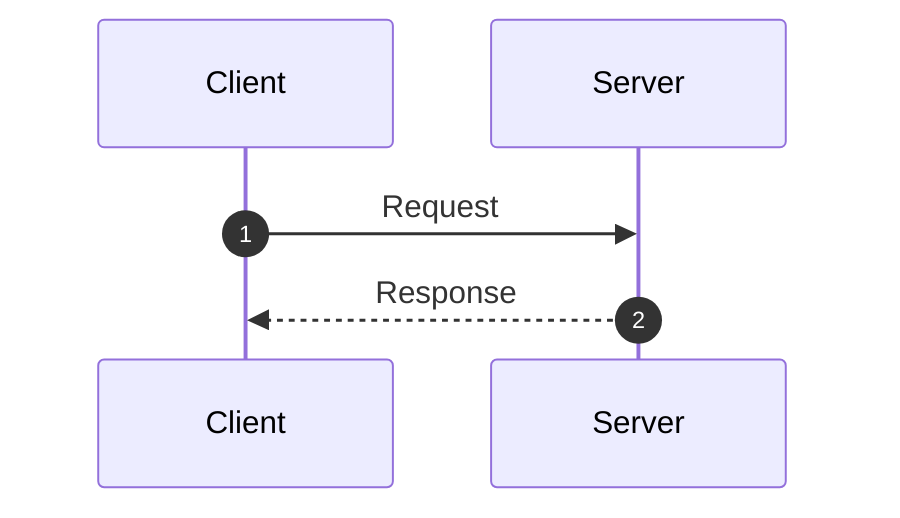

#### Class

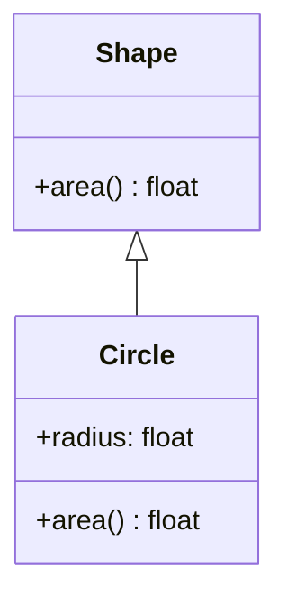

#### State

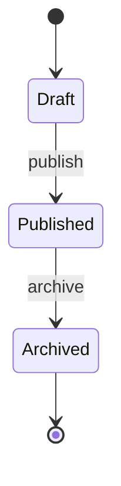

#### Entity Relationship

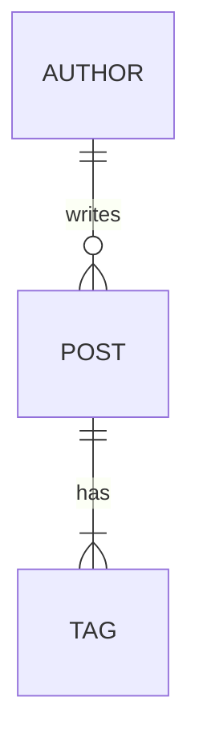

#### User Journey

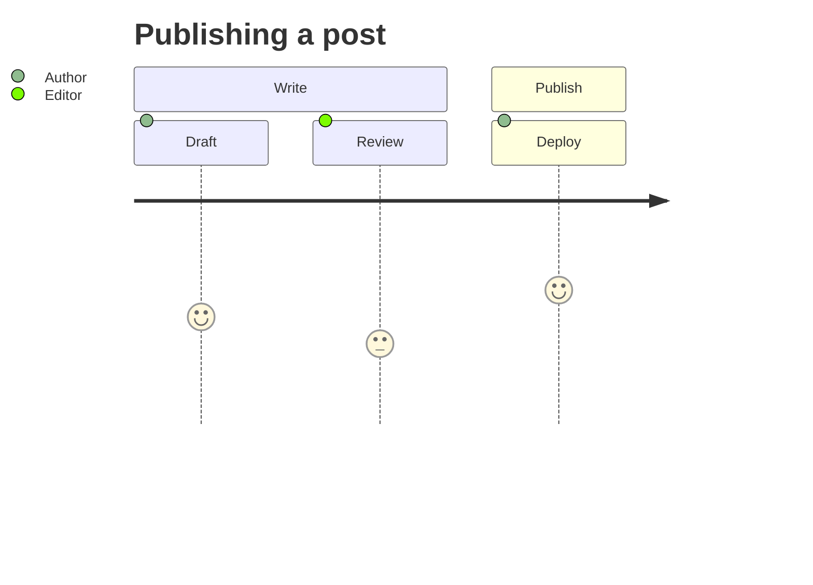

#### Gantt

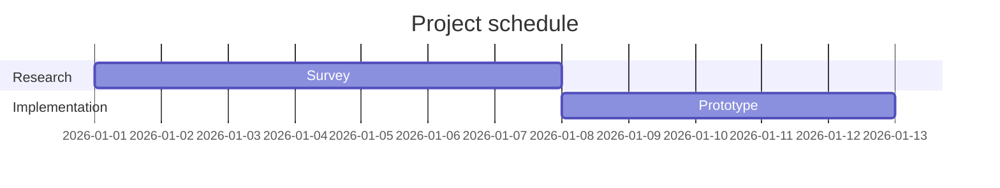

#### Pie

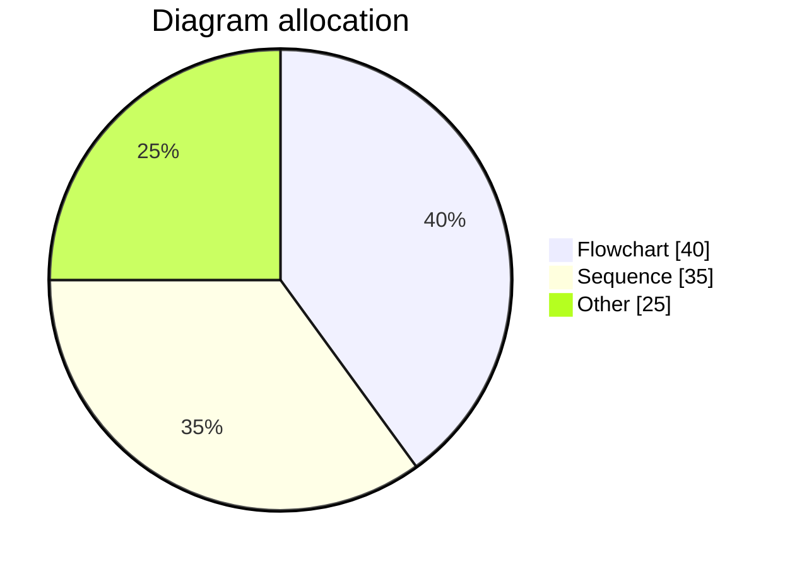

#### Quadrant Chart

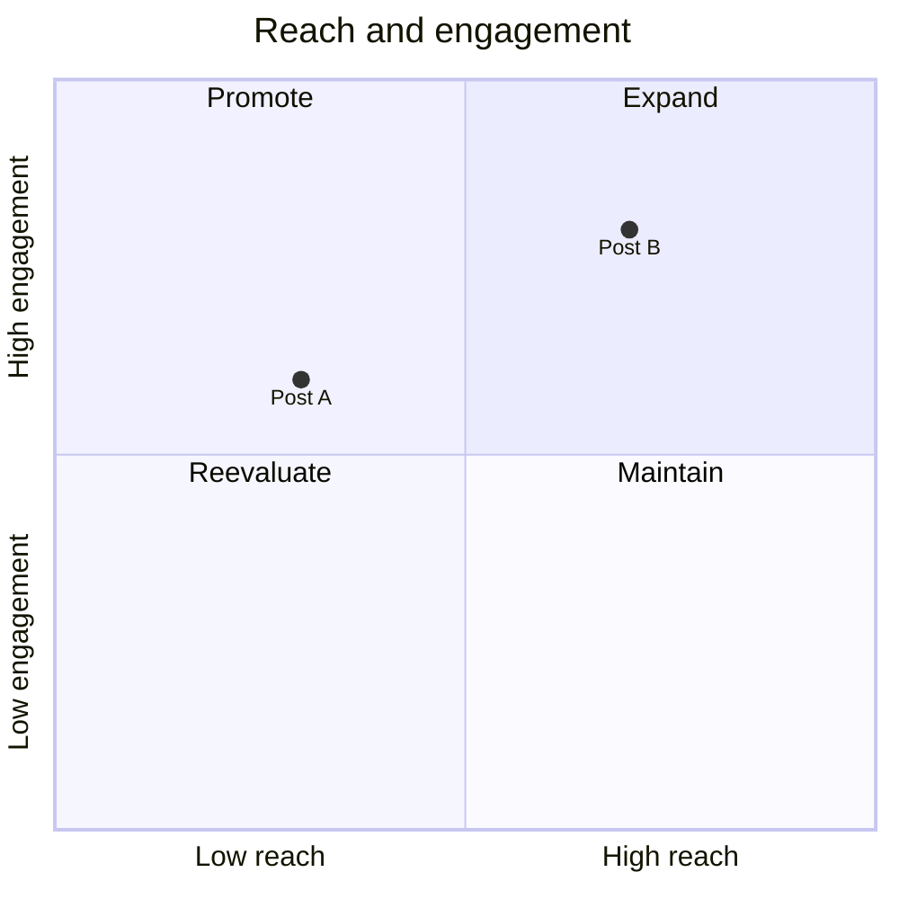

#### Requirement

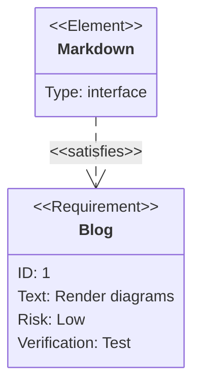

#### Git Graph

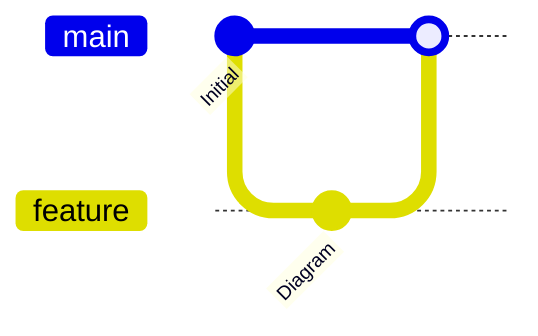

#### C4 Context

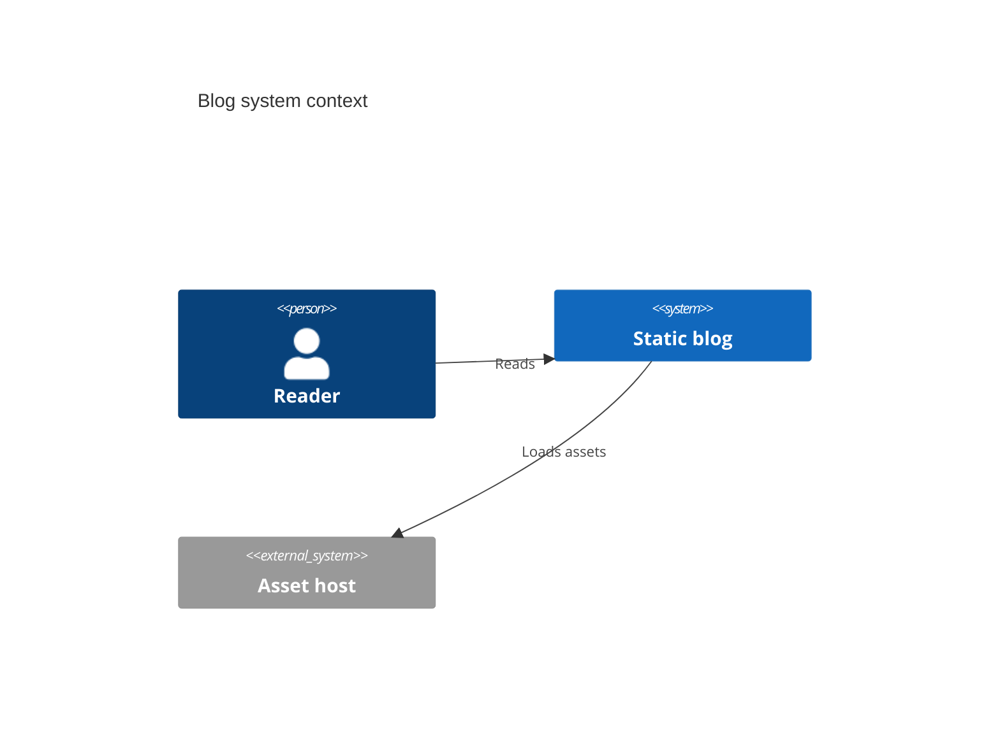

#### Mindmap

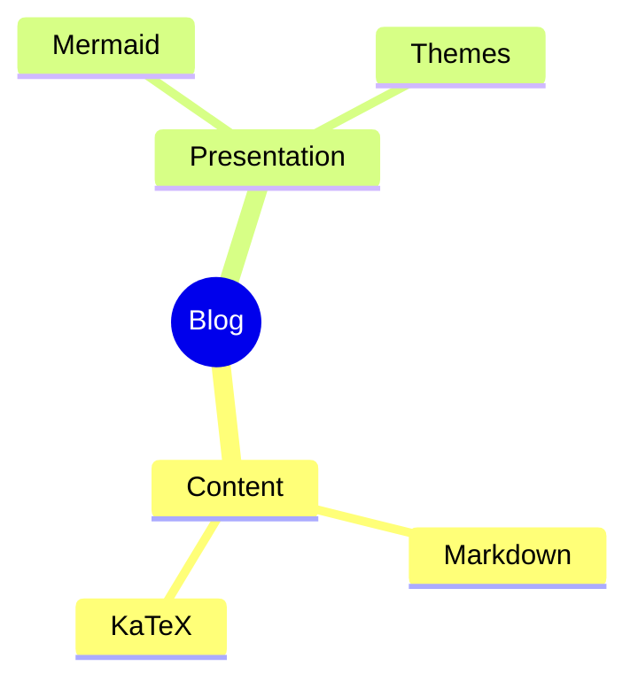

#### Timeline

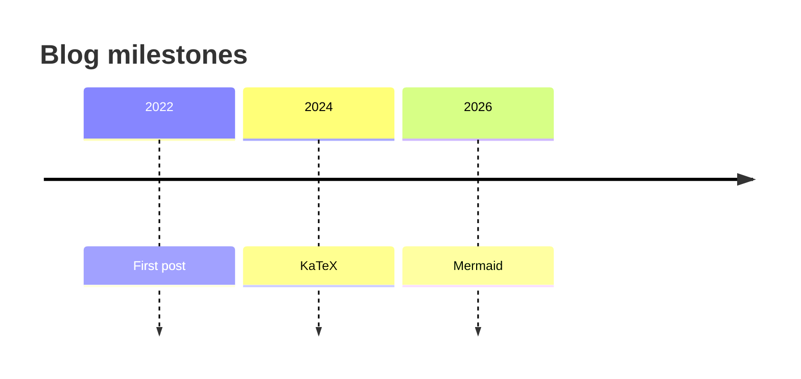

#### ZenUML

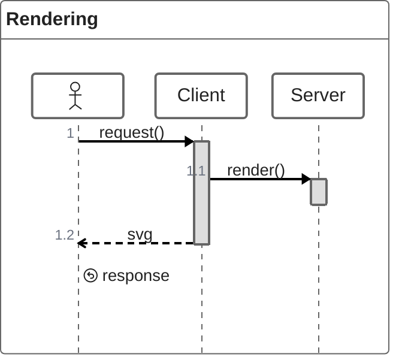

#### Sankey

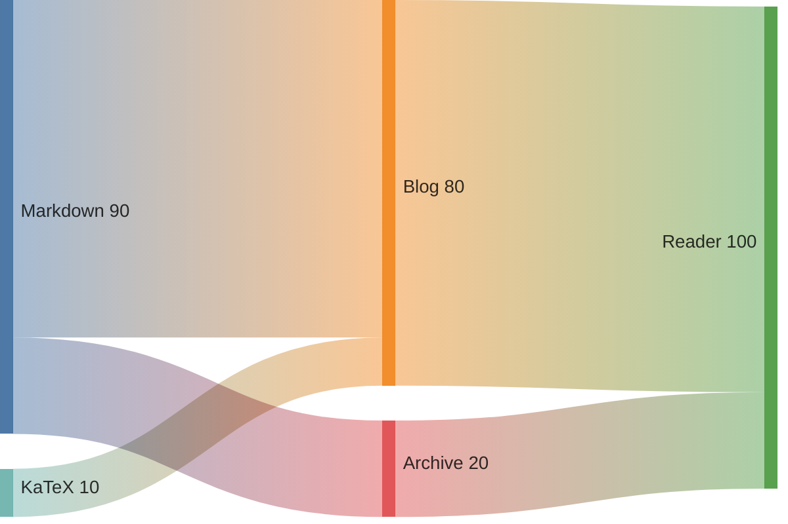

#### XY Chart

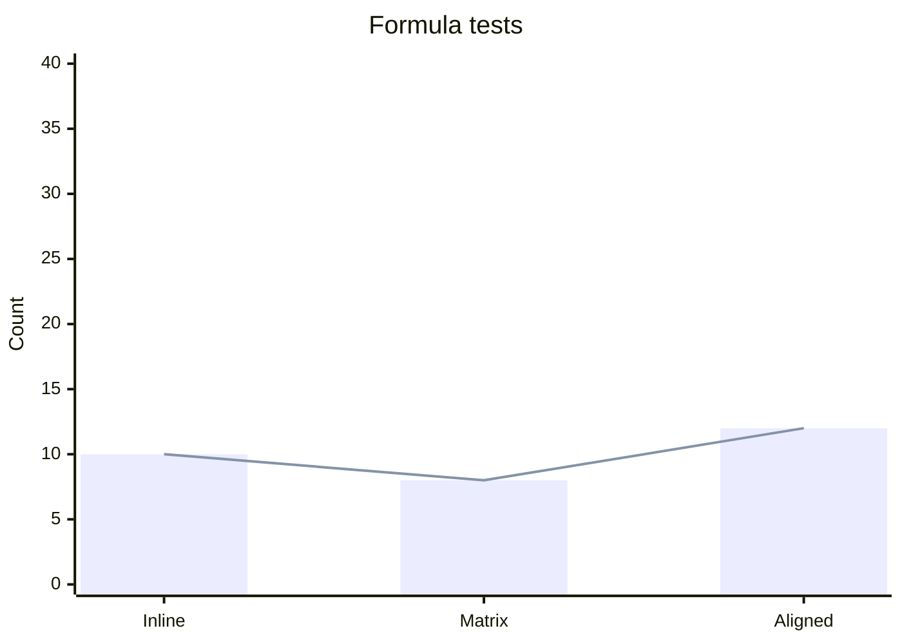

#### Block


#### Packet

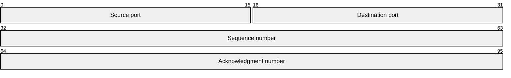

#### Kanban

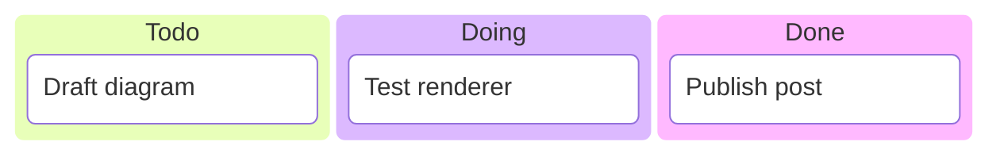

#### Architecture

```mermaid
architecture-beta
    group site(cloud)[Static Site]
    service browser(internet)[Browser]
    service assets(disk)[Assets] in site
    browser:R --> L:assets
```

#### Radar

```mermaid
radar-beta
    title Diagram coverage
    axis m["Markdown"], k["KaTeX"], d["Diagrams"]
    curve a["Current"]{90, 90, 80}
    max 100
    min 0
```

#### Treemap

```mermaid
treemap-beta
    "Blog"
        "Posts"
            "Markdown"
            "Formulas"
        "Assets"
            "Mermaid"
```

#### Frontmatter and Directives

```mermaid
---
title: Configured flowchart
config:
  theme: neutral
  look: classic
  layout: dagre
---
%%{init: {"flowchart": {"curve": "linear"}}}%%
flowchart LR
    A[Directive] --> B[Frontmatter]
```

### Theme-specific Widgets

#### Alert Bars











#### Alert Panels


This panel contains **Markdown** and inline math $\int_0^1 x^2\,dx = \frac{1}{3}$.



Check the following derivation:

$$
\begin{aligned}
a + b &= c, \\
x + y &= z.
\end{aligned}
$$



The panel also contains a Mermaid diagram:

```mermaid
flowchart LR
    A[Panel] --> B[Mermaid]
```


#### Collapsible Blocks


This hidden block contains inline math $\mathbf{x}^{\mathsf{T}}\mathbf{A}\mathbf{x}$ and **bold Markdown**.



This block starts open with a multi-row derivation:

$$
\begin{aligned}
\left\lfloor \frac{n}{2} \right\rfloor + \sqrt{a^2 + b^2} &= c, \\
a + b &= c, \\
x + y &= z.
\end{aligned}
$$



A collapsed Mermaid diagram must also render when revealed:

```mermaid
flowchart TB
    Start[Collapsed] --> Visible[Visible diagram]
```


A blurred inline spoiler: .

More info: [Deployment](https://hexo.io/docs/one-command-deployment.html)

